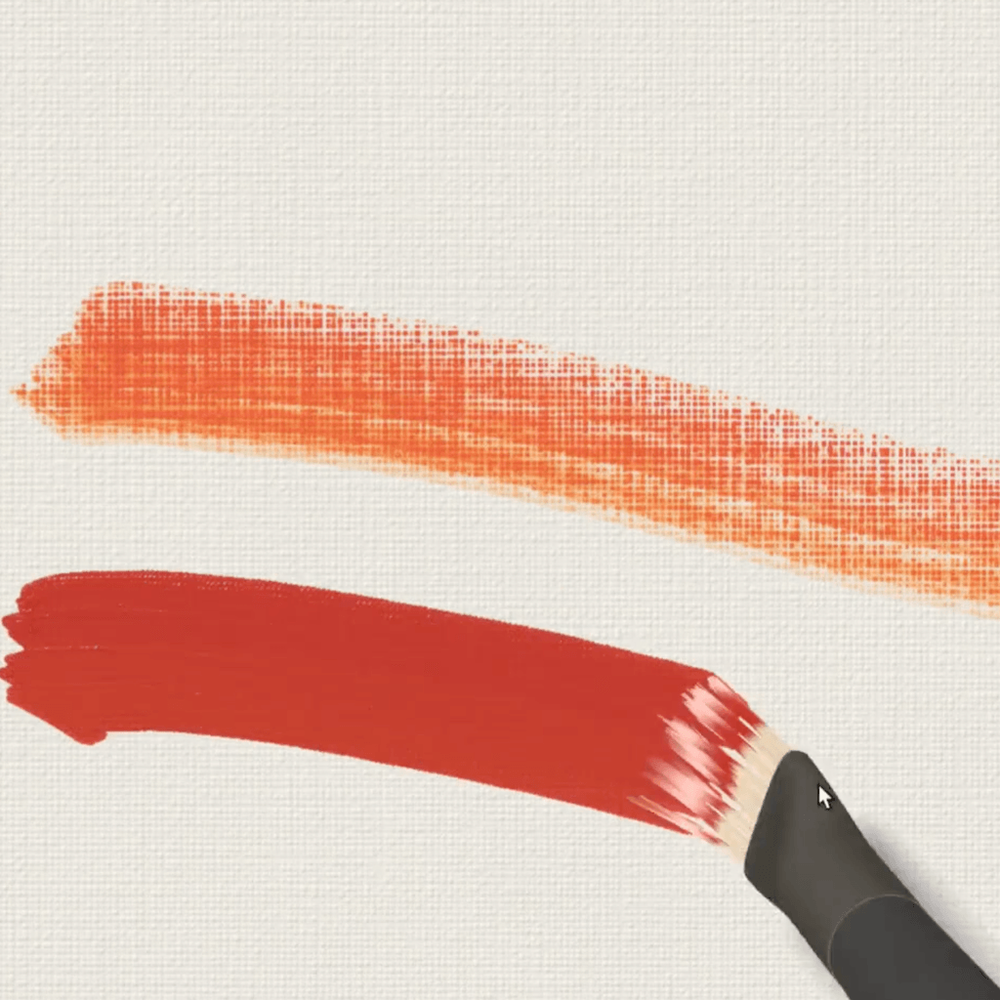
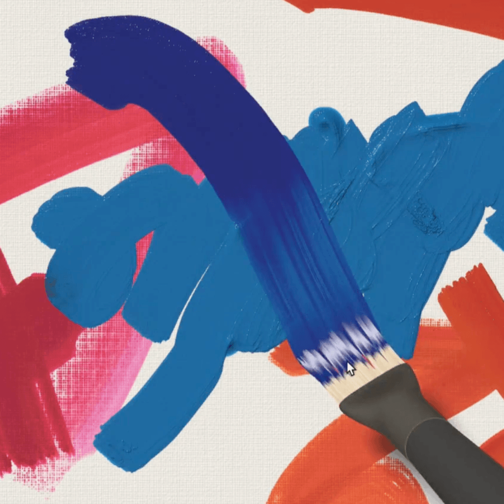
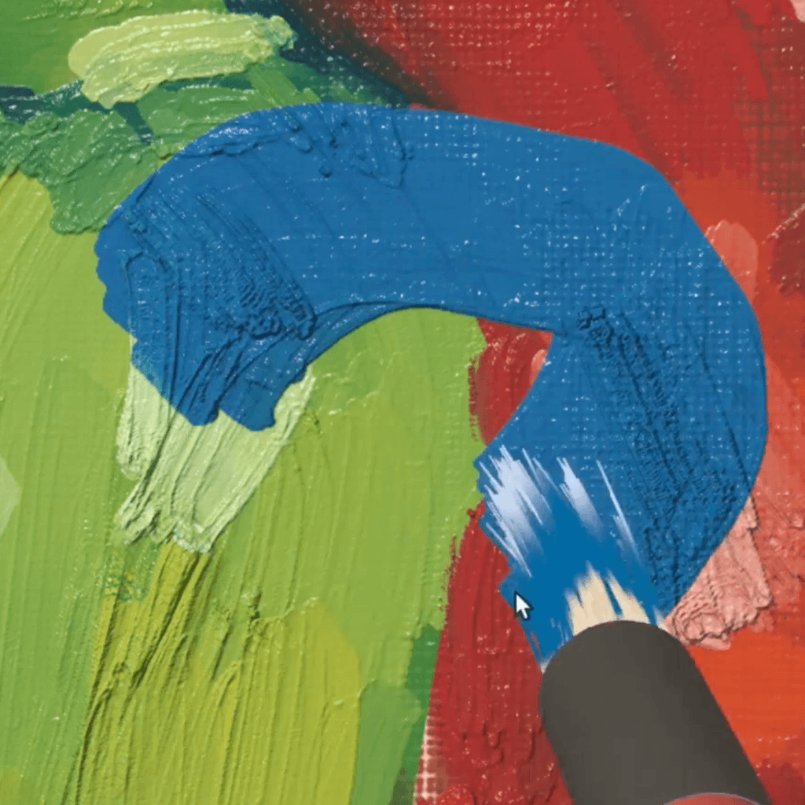
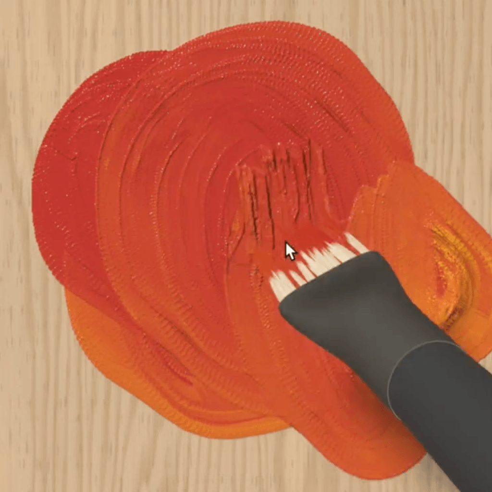
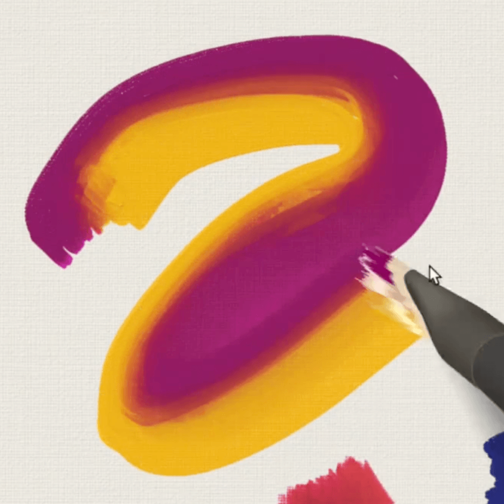
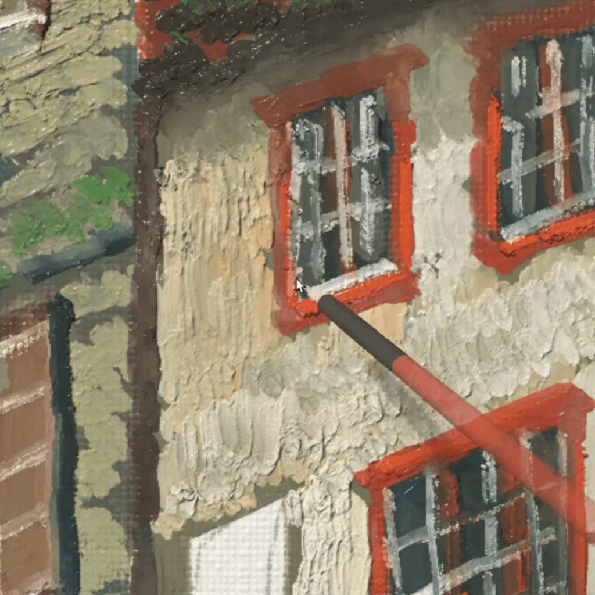
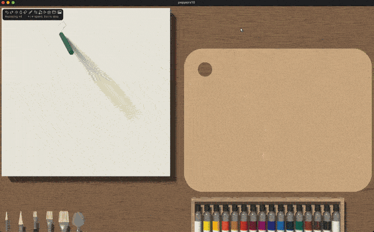
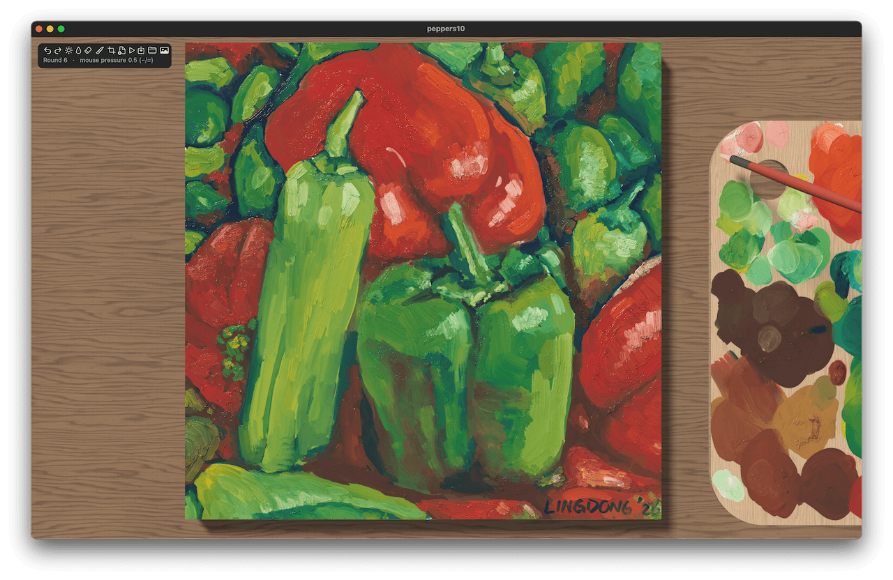

# PaintIRL

Very realistic oil painting app/simulator.

|  |  | 
|---|---|
|  |  | 
|  |  | 

Currently works on macOS (Metal) and web (webgpu), see respective folders fo implementation.

Caution: mostly vibe-coded, so don't look too hard inside. But seems to work well. Here're some paintings I'm making with it:

The [peppers standard test image](https://sipi.usc.edu/database/database.php?volume=misc&image=13)

